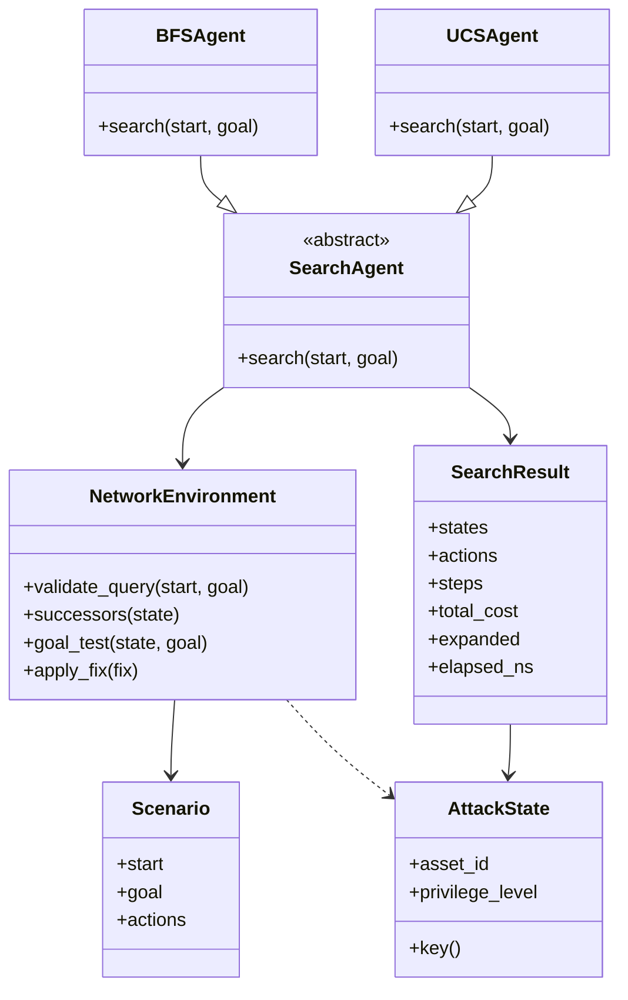
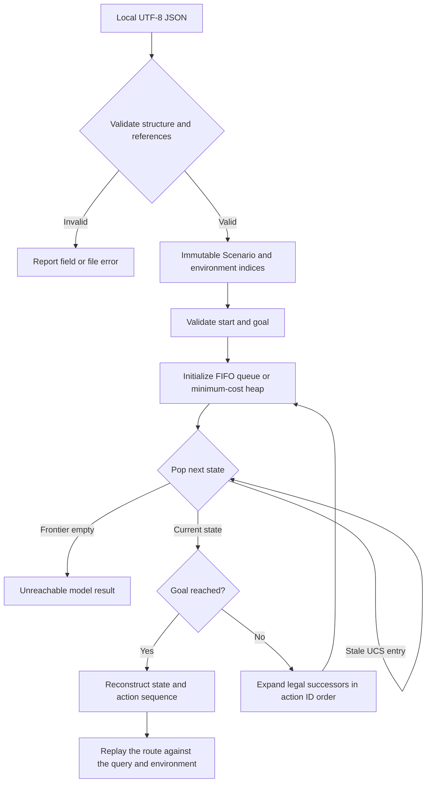

# Architecture

The application treats the synthetic scenario as a directed state graph. JSON records describe candidate actions and their preconditions. The environment derives legal successors for the current state. Both agents search those successors through the same interface.

## Modules

| Module | Responsibility |
| --- | --- |
| `src/paths.py` | Resolve bundled scenarios, result locations and figure locations from the project root |
| `src/models.py` | Define immutable state, goal, scenario, action and fix records |
| `src/validation.py` | Read bounded UTF-8 JSON, validate structure and references, build immutable models |
| `src/environment.py` | Index records, validate queries, enforce preconditions and derive legal successors or fixed environments |
| `src/agents.py` | Define the shared agent contract and implement BFS, UCS and result reconstruction |
| `src/verification.py` | Replay reported routes and check their consistency and goal |
| `src/remediation.py` | Compare both searches on the original model and a one-record variant |
| `src/cli.py`, `src/main.py` | Accept queries and display routes, fixes and metrics |
| `src/network_plot.py` | Draw declared directed connectivity with deterministic placement |
| `src/reporting.py` | Format route labels and export comparison and preview records |
| `src/scenario_generator.py` | Produce and serialize deterministic synthetic instances |
| `src/experiments.py` | Verify checked cases, run paired comparisons and export measurements |
| `src/visualise.py` | Draw comparison charts using saved experiment metrics |
| `src/report_document.py` | Render the academic report Markdown and its figures to PDF |

## Class relationships

`AttackState` has exactly two fields and stable hashing and equality. It is a frozen, ordered dataclass. `key()` returns the two field values. The privilege hierarchy uses explicit numeric ranks, independent of lexical ordering.

`NetworkEnvironment` encapsulates private indices and exposes a read-only scenario. `SearchAgent` owns an environment and defines the search interface. Each child class overrides `search` using its own frontier strategy. The same UI, remediation and experiment callers can invoke either agent through that shared interface.

## Validation and search flow

Each state identifies one asset and its current privilege. There are at most three states per asset. A goal requires the target asset plus a level at or above the required rank. A cross-asset action sets the exact grant on the destination asset. A local action requires a strict privilege increase. Credentials are capability records usable only at their one source asset under declared conditions.

BFS marks states discovered at enqueue time, so first discovery assigns the predecessor for a minimum-depth route. UCS keeps an integer best effort per state, inserts a new heap entry for a strict improvement and discards stale entries when popped. Equal cumulative efforts follow insertion order. Both behaviors depend on the environment's ascending action-ID order for repeatability. A goal counts as found when it is taken from the frontier and passes the goal test.

One expansion is counted each time a current frontier state fails the goal test and the agent calls `successors`. Discoveries count distinct states seen, including the start. Each search measures elapsed nanoseconds with a monotonic clock around its search and path reconstruction. Loading, validation of the query, replay, plotting and UI rendering take place outside the timed interval. An unreachable result has absent step and effort metrics. A start that meets the goal yields one state, zero actions, zero effort and zero expansions.

## Remediation data flow

1. Validate the same start and goal for both models.
2. Run both agents against the original environment.
3. Replace the enabled flag on exactly one declared record and create a new environment around the derived scenario.
4. Rerun both agents, compare action sequences and metrics, and report the changed record and modeled effects.

The baseline consists of frozen records and tuples. The derived model shares immutable records where possible. A candidate action denied by the modified model remains in the scenario for inspection. Route replay uses the environment appropriate to the result being checked.

## Experiment pipeline

The experiment runner checks six fixture baselines against independently calculated expectations. It generates the timed scenarios with a private seeded random source, constructs each validated query before timing, runs paired BFS and UCS trials, and validates results outside the search clock. CSV output captures both per-trial times and aggregate metrics. Matplotlib receives the aggregate results and renders the three labeled charts. The dashboard reads those outputs when available.
