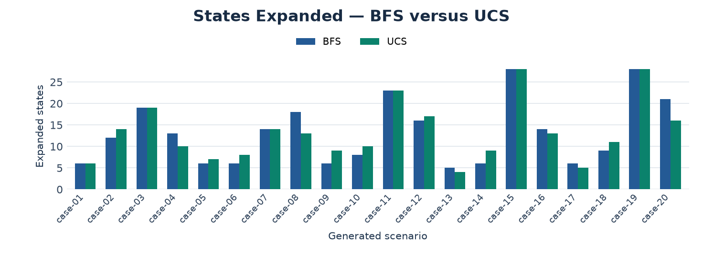
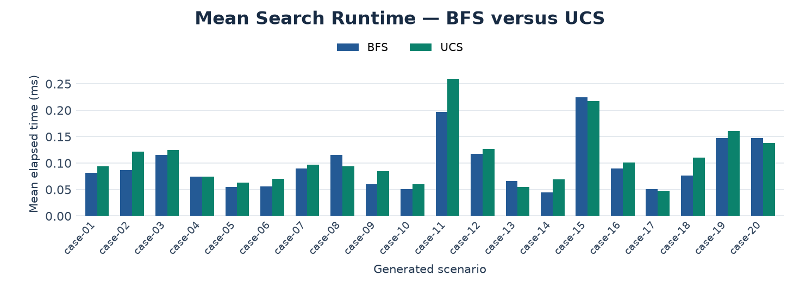
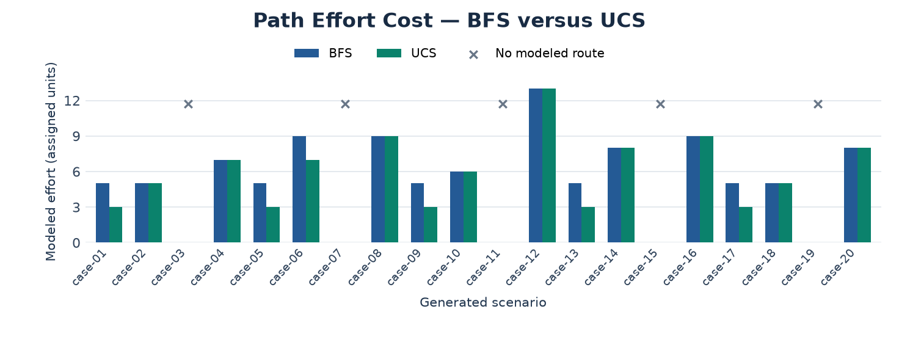

# Attack-Path Analyzer and Remediation Planner

**Semester project report**

AL-2002 Artificial Intelligence Laboratory, Fall 2026  
FAST — National University of Computer and Emerging Sciences, Karachi Campus  
FAST School of Computing, Department of Artificial Intelligence & Data Science

| Project record | Detail |
| --- | --- |
| Original proposal | 21 October 2026 |
| Proposed project type | Own idea, pending instructor approval |
| Proposed category | Part B — Applied / Data |
| Core AI technique | Lab 04 uninformed graph search |
| Proposed group | Muhammad Mutahir, Syed Muhammad Muzamil and Muhammad Abdullah |

## 1. Problem and objectives

Access conditions in a network can interact. A link to an intermediate asset might lead to a target only when a service is enabled, the current privilege meets an access rule, and a declared capability permits the transition. Listing connections alone leaves those conditions unresolved. The project makes the relationships explicit in a synthetic model and demonstrates how two search strategies navigate the same state space.

The application accepts a starting asset and assumed privilege, plus a target and required privilege. Breadth-first search (BFS) finds a path with the fewest actions. Uniform-cost search (UCS) finds a path with the least total assigned effort. Each displayed action identifies the modeled conditions that permit it. A single-record fix preview reruns both searches using the same query.

### Scope and deliverables

- Validate synthetic scenarios and show errors at the relevant field or record.
- Compare original BFS and UCS implementations and replay reported routes.
- Inspect declared topology, configure a query and preview a fix through a local Streamlit or terminal interface.
- Verify six hand-checked fixtures and use seeded synthetic cases for repeatable measurements.

Every result is conditional on the supplied model. An effort value is an assigned teaching unit. A route is a legal sequence of declared state changes.

<!-- pagebreak -->

## 2. State and environment

### PEAS formulation

| Component | Project formulation |
| --- | --- |
| Performance | Goal-path validity, the chosen objective, state expansions, search elapsed time and correct modeled fix impact |
| Environment | A finite directed synthetic network with assets, privileges, links, services and explicit candidate rules |
| Actuators | Generate legal successor states, explain a route and preview a change to a derived model |
| Sensors | Validated local JSON, a start state, a goal specification and an optional fix |

The planner is goal-based. Within the supplied scenario it is fully observable, deterministic, static during each search, discrete and single-agent. A preview builds a second static instance and compares two independent runs.

### State, goal and objective

A state is the pair `(asset_id, privilege_level)`. Every asset uses the same ordered levels `guest < user < admin`. The goal test checks that the asset matches and the current rank meets or exceeds the required rank. The maximum number of states is three times the number of assets. A rule's remote destination grant applies exactly on entry. A local grant must increase the current rank.

Each action has an integer effort from 1 through 5. Route effort is the sum of its action costs. BFS uses action count as its objective. UCS uses the sum. A start that already meets the goal yields a zero-action route with zero effort.

### Transition families

| Family | Legal when | Grant |
| --- | --- | --- |
| Vulnerable-service access | The rule matches the source. Its directed connection, destination service and declared service weakness are enabled. Required levels and any permission hold. | The weakness's destination privilege |
| Local privilege escalation | A local weakness belongs to the current asset and is enabled. Required levels and any local permission hold. Its grant increases the current privilege. | A higher level on the same asset |
| Credential-based login | The enabled source-local capability authorizes the enabled login service on a connected destination. Required levels and any permission hold. | The authorization's destination privilege |

A credential capability is a source-local declaration. The state excludes previous locations, collected material and access history. Therefore the legal successors depend solely on the current state and fixed rules.

<!-- pagebreak -->

## 3. Architecture and validation

### Class relationships

```text
Breadth-first frontier       Common contract       Minimum-cost frontier
      BFSAgent -------- inherits SearchAgent -------- inherited by UCSAgent
                                  |
                               holds
                                  v
 AttackState ----------------> NetworkEnvironment -------- owns --> Scenario
 (asset, level)                successors / goal / fix            immutable
                                  |
                            returns legal
                                  v
                             SearchAction

 Both agents return SearchResult with ordered states, actions and metrics.
```

`AttackState` is an immutable value object. It supports stable hashing, equality and a comparable key. `NetworkEnvironment` encapsulates validation of search queries, private record indices and transition evaluation. `SearchAgent` declares the abstract search method, which `BFSAgent` and `UCSAgent` override. Comparison, experiments and remediation invoke the same contract with either concrete agent.

### Scenario and transition validation

`src/validation.py` reads bounded UTF-8 JSON and requires schema version 1. It checks field types, privilege ranks, IDs, costs and cross-record consistency before constructing a scenario. Directed links connect distinct assets. Credentials may authorize individual login services. An action's referenced service and weakness or authorization must agree with its source and destination. Disabled records remain visible. `successors` evaluates current privilege, enabled flags and any permission before admitting an action.

The [scenario schema](scenario-schema.md) specifies each field and provides valid and invalid examples. The [architecture guide](architecture.md) includes the search-flow diagram.

### Code-to-guideline mapping

| Guideline | Where to inspect |
| --- | --- |
| Labs 01–02, Python and OOP | `src/models.py`, `src/environment.py` and `src/agents.py` show value objects, encapsulation, inheritance and overrides. |
| Labs 01–02, seeded reproducibility | `src/scenario_generator.py` owns a private random sequence and serializes canonical JSON. |
| Lab 03, agents and environment | Section 2 and the goal and successor methods in `src/environment.py` describe and implement PEAS behavior. |
| Lab 04, own search and baseline | `src/agents.py` defines FIFO and heap-based search, parent reconstruction and counters. |
| Experiment and practice | `src/experiments.py`, `src/visualise.py`, `tests/`, the README and pinned dependencies support evaluation and use. |

<!-- pagebreak -->

## 4. Search and correctness

### Breadth-first search

BFS enqueues the start. On removing a state, it checks the goal. Otherwise it generates legal successors and enqueues each unseen state while storing the incoming action. The FIFO queue processes depth layers in increasing order. The first discovery of each state therefore has minimum depth. Following the parent chain of the first popped goal returns a minimum-action path. A cycle cannot repeatedly enqueue states that were already discovered.

### Uniform-cost search

UCS keeps a heap ordered by cumulative effort and a best-known cost for each state. A new strict improvement replaces the parent and pushes a new entry. A popped entry with a superseded cost is skipped. The current goal is accepted when it leaves the heap. Because edge costs are positive, any strictly cheaper goal path would contain a cheaper prefix, which the heap would process earlier. Parent reconstruction therefore yields a minimum-effort path.

Successors follow ascending action-ID order. BFS preserves that order through the queue. UCS uses insertion order for equal-cost heap entries and retains the existing parent on equal-cost relaxations. An expansion counts a current popped state that fails the goal test and has its successors generated. Stale entries and returned goals contribute no expansions.

### Independent checks

`src/verification.py` checks the requested start, each state's agreement with its action, legal successors, the final goal and the reported step and effort totals. This validates returned paths without using the solver's frontier. For an unreachable result, it checks the absence of path values. The independent fixture expectations and search tests assess reachability and optimality.

| Fixture | BFS steps / effort | UCS steps / effort | Independent check |
| --- | --- | --- | --- |
| Simple path | 3 / 5 | 3 / 5 | Only route costs 2 + 1 + 2 |
| Cost trade-off | 1 / 5 | 2 / 2 | Direct action costs 5. Two-step route costs 1 + 1. |
| Unreachable goal | None | None | Disabled connection prevents the sole final transition. |
| Cycle | 2 / 4 | 2 / 4 | Revisiting entry fails to improve the route. |
| Blocking fix | 1 / 2 | 1 / 2 | Blocking the only relevant link removes both routes. |
| Alternate route | 1 / 2 | 1 / 2 | Disabling the direct weakness leaves a 2-step, effort-4 route. |

<!-- pagebreak -->

## 5. Interface, fixes and testing

The Streamlit dashboard loads a bundled scenario or validates a local JSON upload. Its explorer displays declared assets, directed links, services and access conditions. Query controls select the starting asset and level plus the target and required level. The comparison shows both routes, cost, steps, expansions and search time. Individual actions include effective minimum privilege, the resulting state, relevant record IDs and cumulative effort. The console provides the same search and explanation with an optional local JSON export.

### Fix previews

`preview_fix` runs both agents on the original and derived environments. It replays all results and reports the changed record. Disabling a weakness blocks actions that reference that grant. Revoking access disables a source-local credential capability or a permission record. Blocking a directed connection denies remote actions referencing that connection. The preview counts affected legal state/action transitions across the model and compares routes for the selected query.

For the blocking fixture, disabling `link_entry_archive` removes the modeled route. For the alternate fixture, disabling `weak_a_direct` causes the route through the relay to replace the original. An irrelevant fix can leave the query's selected route unchanged. Frozen records keep the baseline available for a fresh preview.

### Test method and results

The complete pytest suite ran on Windows using Python 3.12.10 and reported **114 passed, 0 failed and 0 skipped**. The separately launched Streamlit process returned HTTP 200 for its local root and health endpoints. A Chromium check rendered the graph and exercised comparison, fix preview and discard, valid and invalid JSON uploads, and experiment downloads. That session recorded zero external HTTP requests and zero page script errors.

Tests cover schema errors, every action family and its denied preconditions, independent baseline paths, stable tie behavior, stale UCS entries, unreachable goals, start-is-goal, cycles, fix outcomes, deterministic generation, export and interface startup. The verification commands and fixtures are documented in the README. The suite also checks that a preview preserves the baseline and that invalid models report an actionable error.

### Reproduce locally

```bash
python -m pytest -q
python -m src.cli --scenario data/scenarios/checked/simple_path.json
python -m streamlit run src/main.py
python -m src.experiments --seed 42 --cases 20 --repeats 10
```

The Python 3.12 environment passed the dependency check. The console also ran with Python 3.11.9. Linux setup is documented. Execution on Linux and a clean clone on a different machine remain pending.

<!-- pagebreak -->

## 6. Experimental setup and paired results

The standard runner verifies six checked baselines, then generates 20 cases with version 1 and seed 42. It alternates the algorithm order and records ten trials per agent on each identical query. Its monotonic timer covers the search. Loading, replay, export and plotting take place outside the timer. The runner has no warm-up trials.

The four patterns contribute five models each. They exercise a cost trade-off, two branches, a disabled final grant or a cycle with a local privilege change. Additional directed branches vary what expansions encounter. This run's models span 11 to 30 assets.

Two executions reproduced all 20 input hashes and the 40 logical result rows. Both agents reached the modeled target in 15 cases. All 30 reported reachable paths passed replay.

Cells present BFS / UCS. The dash denotes absent path metrics on an unreachable instance.

| Case | Structure | Assets | Steps | Effort | Expanded |
| --- | --- | --- | --- | --- | --- |
| case-01 | trade-off | 30 | 1 / 3 | 5 / 3 | 6 / 6 |
| case-02 | branching | 18 | 2 / 2 | 5 / 5 | 12 / 14 |
| case-03 | unreachable | 20 | - | - | 19 / 19 |
| case-04 | cyclic | 14 | 4 / 4 | 7 / 7 | 13 / 10 |
| case-05 | trade-off | 17 | 1 / 3 | 5 / 3 | 6 / 7 |
| case-06 | branching | 20 | 2 / 3 | 9 / 7 | 6 / 8 |
| case-07 | unreachable | 15 | - | - | 14 / 14 |
| case-08 | cyclic | 20 | 4 / 4 | 9 / 9 | 18 / 13 |
| case-09 | trade-off | 28 | 1 / 3 | 5 / 3 | 6 / 9 |
| case-10 | branching | 13 | 2 / 2 | 6 / 6 | 8 / 10 |
| case-11 | unreachable | 24 | - | - | 23 / 23 |
| case-12 | cyclic | 21 | 4 / 4 | 13 / 13 | 16 / 17 |
| case-13 | trade-off | 24 | 1 / 3 | 5 / 3 | 5 / 4 |
| case-14 | branching | 13 | 2 / 2 | 8 / 8 | 6 / 9 |
| case-15 | unreachable | 29 | - | - | 28 / 28 |
| case-16 | cyclic | 14 | 4 / 4 | 9 / 9 | 14 / 13 |
| case-17 | trade-off | 11 | 1 / 3 | 5 / 3 | 6 / 5 |
| case-18 | branching | 30 | 2 / 2 | 5 / 5 | 9 / 11 |
| case-19 | unreachable | 29 | - | - | 28 / 28 |
| case-20 | cyclic | 21 | 4 / 4 | 8 / 8 | 21 / 16 |

The summary CSV stores paths, costs, expansions and per-case mean, median and standard deviation. The raw CSV contains 400 search timing records across 20 distinct models. Repeated measurements characterize the search on each model. [Summary CSV](../outputs/results/search_summary.csv) · [Raw timing CSV](../outputs/results/search_timings.csv)

<!-- pagebreak -->

## 7. States expanded



Figure 1. State expansions per generated instance under the shared counting rule.

| Algorithm | Mean per case | Median per case | Minimum | Maximum |
| --- | --- | --- | --- | --- |
| BFS | 13.2 | 12.5 | 5 | 28 |
| UCS | 13.2 | 12 | 4 | 28 |

BFS expanded fewer states in 8 cases and UCS in 6. Counts tied in 6, including all five unreachable instances. Both expanded 264 states across the 20 models. Equal totals can conceal differences on individual cases.

The two frontier policies can process different states before reaching a goal. BFS gives priority to the shallowest states. UCS gives priority to cheap prefixes, even when those prefixes contain extra moves. In a finite unreachable instance, both algorithms exhaust all reachable states. The figure includes those comparisons because expansions remain meaningful when a path is absent.

<!-- pagebreak -->

## 8. Search runtime



Figure 2. Mean search-only time per generated instance across ten repetitions per algorithm.

| Algorithm | Pooled mean (ms) | Pooled median (ms) | Pooled SD (ms) | Within-case SD (ms) |
| --- | --- | --- | --- | --- |
| BFS | 0.1509 | 0.1071 | 0.1209 | 0.0024 to 0.2268 |
| UCS | 0.1641 | 0.1173 | 0.1089 | 0.0029 to 0.0975 |

The table pools 200 observations per algorithm for the mean, median and population standard deviation. Its last column gives the range of per-case population standard deviations across the 20 models. The two pooled medians differ by about 0.0102 ms in this run. The chart uses each case's own mean.

Each observation is a short local search. Timings depend on the interpreter, machine load and case. Individual differences support describing this run and its variability. Step and effort optimality follow from the algorithms and legal transitions.

<!-- pagebreak -->

## 9. Modeled path effort



Figure 3. Total assigned effort of the selected routes. Unreachable cases have no path-effort value.

| Algorithm | Reachable cases | Mean effort | Median effort | Mean actions |
| --- | --- | --- | --- | --- |
| BFS | 15 | 6.93 | 6 | 2.33 |
| UCS | 15 | 6.13 | 6 | 3.07 |

UCS reduced effort in 6 reachable cases and tied BFS in 9. BFS selected fewer moves in 6 cases and tied UCS in 9. In case-01, the one-step route selected by BFS costs 5 effort units. UCS uses three steps at a total of 3.

The assigned weights make trade-offs visible. BFS can return a short route with a larger effort sum. UCS can return a longer route with a smaller sum. When all candidate routes to a target have the same effort, either algorithm may select an equally good route under the effort objective.

<!-- pagebreak -->

## 10. Conclusions and academic record

BFS and UCS searched the same declared state graph and agreed on reachability. The checked cost trade-off and six generated cases showed how each objective can select a different route. The fix fixtures verified both removal of a route and selection of an alternative under one-record changes.

### Limitations and possible follow-up

The planner assumes a static, fully specified graph. A missing rule can make a modeled target unreachable. The state excludes retained capabilities and multi-asset history. Fix previews cover one declared record at a time. All findings apply to the synthetic model. The optional lab validation would compare permitted, deidentified observations with selected model assumptions. No lab observations were supplied or collected. Additional synthetic structures and sensitivity checks across assigned costs would extend the evaluation.

### Group and contributions

| Proposed student | Roll number | Proposed role and share | Verified individual work |
| --- | --- | --- | --- |
| Muhammad Mutahir | 24K-2005 | Search, integration and coordination, 34% | Unverified |
| Syed Muhammad Muzamil | 24K-2000 | Dashboard and visualization, 33% | Unverified |
| Muhammad Abdullah | 24K-2055 | Model, scenarios and experiments, 33% | Unverified |

The guideline heading allows up to three students and Section 1 says at most two. The three-person proposal therefore requires instructor clarification. Approval of the own idea, category, group registration, verified individual authorship and commits, public repository, independent clean clone, Classroom submission and viva remain unresolved. The repeated “Build week 1” labels are retained from the proposal. No separate report template was supplied.

### References and acknowledgments

- FAST School of Computing, AL-2002 Project Guidelines, Fall 2026, and the project proposal dated 21 October 2026, supplied locally.
- Python standard-library documentation for the [deque](https://docs.python.org/3/library/collections.html#collections.deque) and [heap](https://docs.python.org/3/library/heapq.html) containers.
- Official documentation for [Streamlit](https://docs.streamlit.io/), [Matplotlib](https://matplotlib.org/stable/), [pytest](https://docs.pytest.org/en/stable/) and [ReportLab](https://docs.reportlab.com/).
- OpenAI Codex assisted with requirements analysis, code and test generation, experiments, verification and writing. ReportLab rendered this PDF. Bundled PDF tools supported source and document checks.
